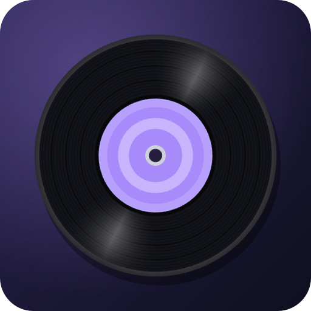

<p align="center"></p>

<h1 align="center">Needledrop</h1>
<p align="center">A spinning vinyl, a real music player and a volume mixer for every sound in Minecraft.<br>
Fabric, Minecraft 26.3, client side only.</p>

> Vibe coded, with AI help and hands-on human fixing and testing.

## What it does

**A disc that follows you.** A spinning vinyl with your song's cover art, title and artist sits in a corner of the pause
menu, the title screen, or the game itself. Skip, pause and change volume right from it. Right-drag it anywhere.
Right-click it to make the disc or the card bigger or smaller, or hide it.

**A music player.** Play your own `.mp3`, `.ogg` and `.wav` files next to Minecraft's own songs and music discs.
Add as many folders as you like, search, shuffle, loop, queue, edit song info and covers, and remove any song from the
list. Files are never deleted.

**Your system's player.** Show and control what YouTube Music, Spotify or any other player is playing, through the
operating system's media session.

**A mixer for every sound.** Turn down 100 cows without muting the game. Sliders for all sounds, categories, mobs,
vehicles, blocks, items, music, weather and every single sound event.

## Install

1. Install [Fabric Loader](https://fabricmc.net/use/) and [Fabric API](https://modrinth.com/mod/fabric-api) for Minecraft 26.3.
2. Put the Needledrop `.jar` in your `mods` folder. [Mod Menu](https://modrinth.com/mod/modmenu) is optional and adds a Configure button.
3. Start the game and press Escape. The disc is in the bottom-left corner. Click it.

Your own songs go in `.minecraft/music_player/`, or add any folder from the Folders button.

## System media (YouTube Music, Spotify)

Set Source to Media apps in the Music tab.

| System | What you need |
| --- | --- |
| Windows | Nothing. A small PowerShell script reads the media session. |
| Linux | `playerctl` |
| macOS | `nowplaying-cli` (`brew install nowplaying-cli`) |

## Settings

Everything is in the Settings tab: where the disc shows (pause menu, title screen, in game), nine anchor positions with
offsets, disc and card size, opacity, vinyl or CD style, colors, spin speed, and a Status section for troubleshooting.
Config file: `config/vinyl-music-player.json`.

## Troubleshooting

If something does not show or react, open Settings, scroll to Status, and read the lines. They tell you which hooks work,
whether mouse events arrive, and which disc renderer is in use. The log (`logs/latest.log`) has lines tagged `VinylMusicPlayer`.

## Build from source

```
gradle build
```

Needs Java 25 and Gradle 9.6. The jar is written to `build/libs/`. The included GitHub Actions workflow does the same
and attaches the jar to a Release.

## Compatibility

Client side only. Works on singleplayer, Realms and any server. The sound mixer scales volume after other mods, so it
stacks with other sound mods.

## Credits

MP3 decoding by [JLayer](https://github.com/umjammer/jlayer) (LGPL), bundled. OGG decoding uses the STB decoder that
ships with Minecraft's LWJGL.

## License

MIT. See [LICENSE](LICENSE).
